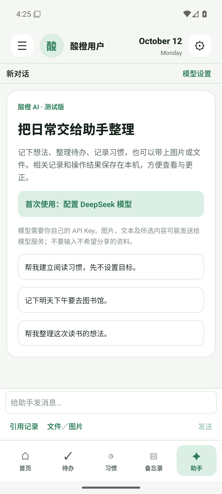
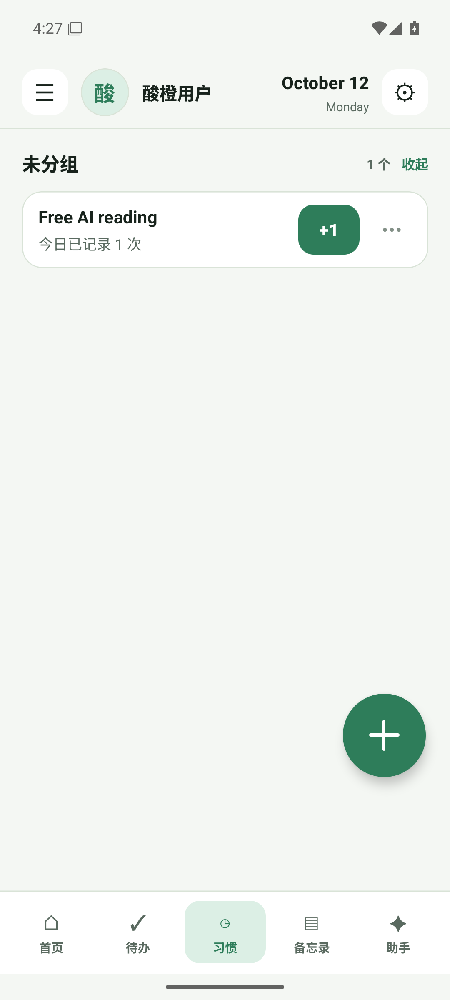
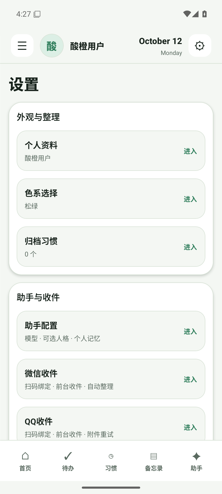
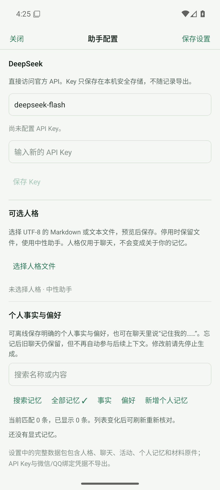

<p align="center"></p>

# 酸橙 AI · Lime 扩展版

**习惯、待办和备忘录，加上帮你整理日常的 AI 助手。** 数据保存在手机，模型和微信/QQ渠道使用用户自己的外部服务账号。

**[下载 AI 测试版 APK](https://github.com/2742360657/Lime/releases/tag/ai-v1.3.0-alpha.1) · [开始使用](docs/ai-usage.md) · [本地版](https://github.com/2742360657/Lime/tree/main) · [当前状态](docs/project-status.md)**

这是独立安装的 alpha，名称“酸橙 AI”，包名 app.lime.personalassistant；可与本地版共存，不覆盖本地版数据。模型/渠道需要自行配置；APK 不含任何 Key、人格或个人记录。

## 界面

<p>
  
  
  
  
</p>

截图来自隔离模拟器，仅使用示例数据；没有伪造模型成功回答。

## 能做什么

| 入口 | 当前功能 |
|---|---|
| 习惯 | 默认自由记录，可选周期目标、分组、打卡、历史和归档；手动/助手共用业务命令 |
| 待办与备忘录 | 手动管理、搜索、来源查看、恢复与本地提醒 |
| 助手 | 自然语言操作、按需查询历史、图片/文件输入、结果与来源回看 |
| 微信/QQ | 用户绑定账号的前台收件、原件保存、重试与收件后处理队列 |
| 模型与资料 | 自行配置 DeepSeek Key、可选人格、可查看记忆 |
| 备份 | 本机记录/聊天/原件的完整 ZIP，凭据不导出；冲突恢复保留副本 |

未代用户验证真实模型语义和真实渠道；服务账号/权限/平台变化会影响实际使用。

## 下载与首次使用

Android 7.0+。普通手机下载 arm64-v8a，x86_64 用于对应模拟器。安装后从“助手 → 配置模型”保存自己的 Key，再按需要绑定渠道。本地习惯、待办和备忘录可先使用。

AI 版需要联网，选定内容可能发送到模型服务；私人 Key 保存在手机安全存储，不随完整数据包导出。详见[开始使用与隐私边界](docs/ai-usage.md)。主线本地版没有联网业务，两个 APK 和备份格式分别维护。

## 开发与 AI 入口

先读 [AGENTS.md](AGENTS.md)、[产品定义](docs/product-scope.md)、[当前状态](docs/project-status.md)。Node 22、JDK 17、Android SDK 36，复用已提交原生工程与锁文件：

```bash
source scripts/env.sh
npm ci
npm run check
bash scripts/android-build.sh preview arm64-v8a
```

正式包使用私密 keystore.properties（LIME_SIGNING_PROPERTIES），`bash scripts/android-build.sh release arm64-v8a,x86_64` 分架构生成 APK；详见 [scripts](scripts/README.md)。不要 prebuild --clean 或把扩展线整体合并进 main。

项目采用 [MIT](LICENSE)，来源与依赖许可见 [NOTICE](NOTICE.md)。GitHub Releases 保存包、SHA256SUMS 和源码/签名清单；APK 不提交到 Git。
