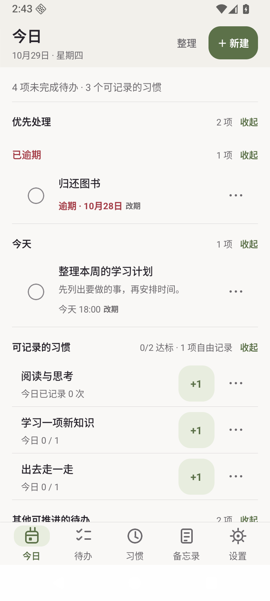
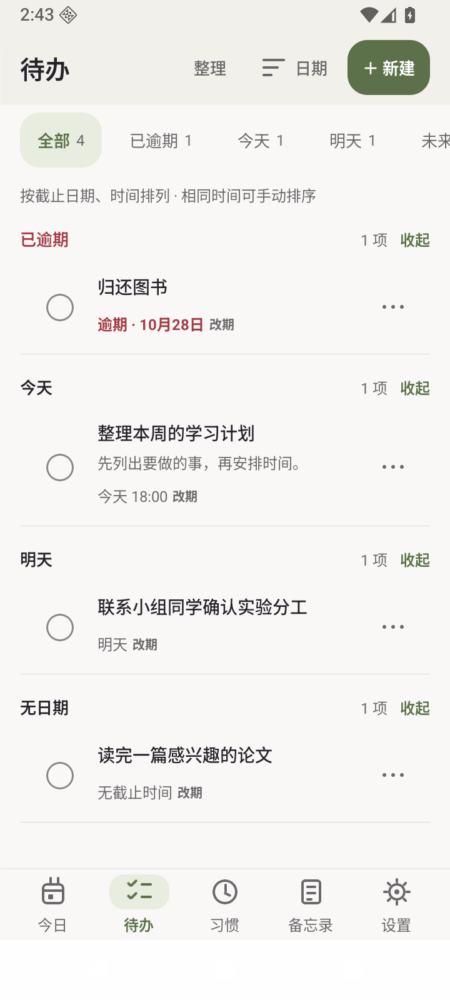
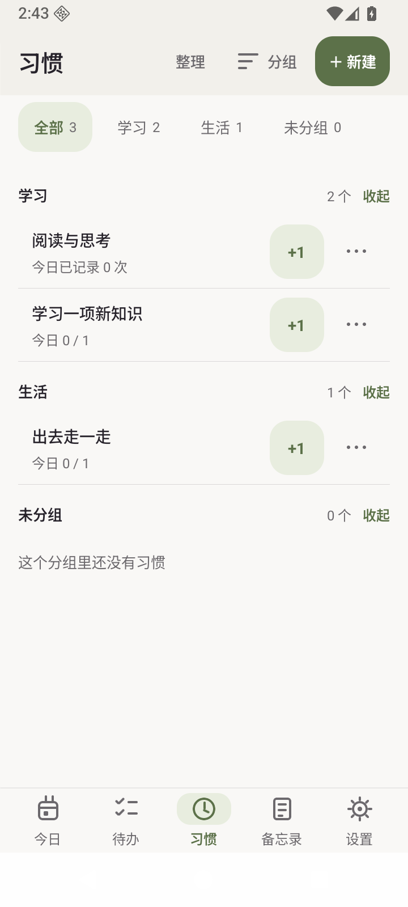
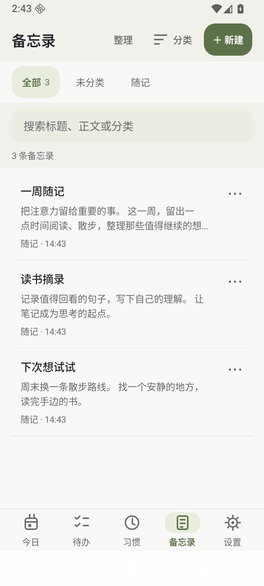
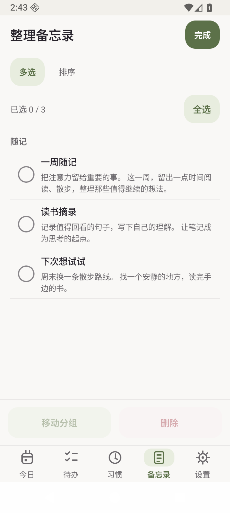
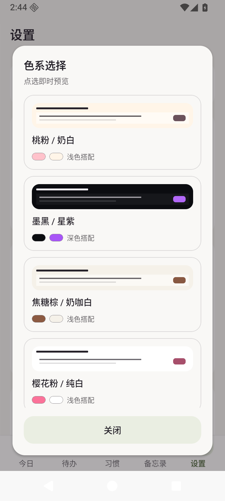
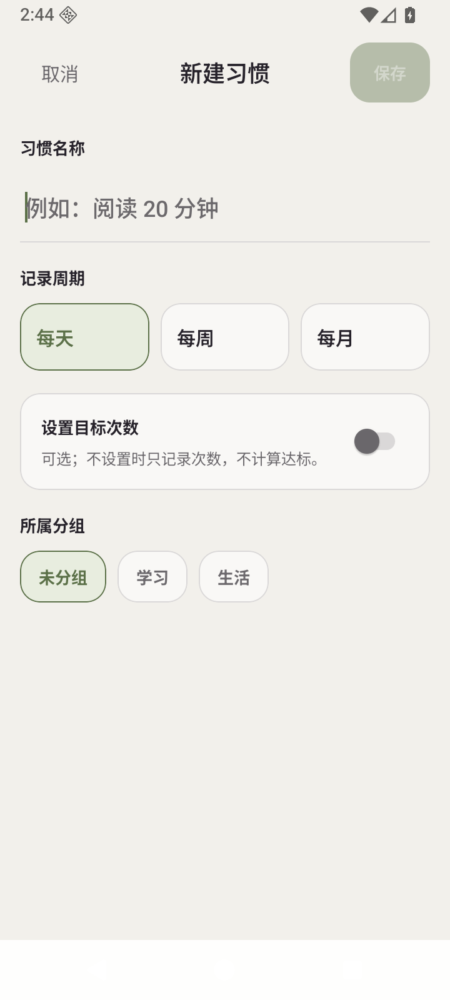
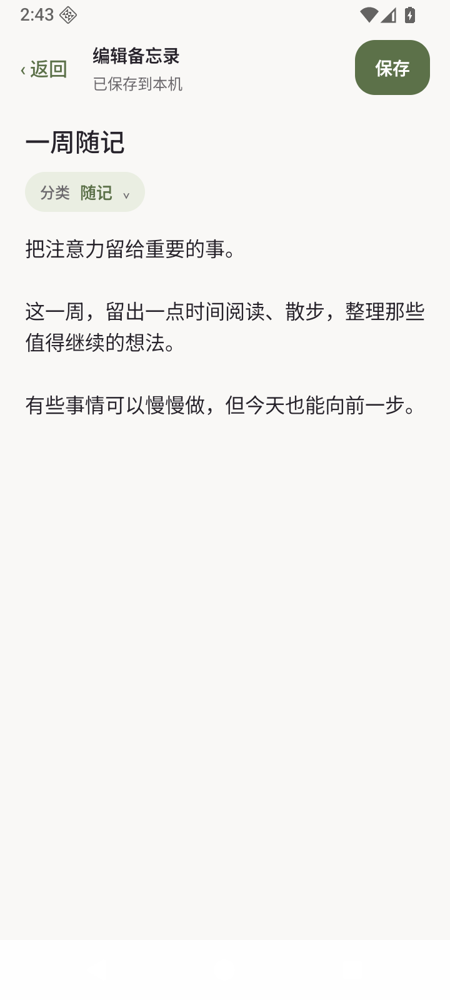

<p align="center"></p>

# 酸橙 · Lime

**把习惯、待办和备忘录放在一个离线 Android 应用里。** 无需账号、无需服务器；日常数据保存在手机，可自行导出和恢复。

**[下载最新 APK](https://github.com/2742360657/Lime/releases/latest) · [使用指南](docs/usage.md) · [开发指南](docs/development.md) · [English](docs/README.en.md)**

## 界面

<p>
  
  
  
  
  
</p>

截图使用隔离模拟器中的示例数据。界面提供十三套配色，覆盖十一套浅色、两套深色搭配，采用统一列表、适中圆角按钮与分层圆角。设置中点选色系可即时预览：



新建习惯默认自由记录；需要周期目标时再打开开关：



备忘录打开即可浏览，点正文原位编辑，支持自然惯性滚动与长按选字：



## 可以做什么

| 功能 | 内容 |
|---|---|
| 习惯 | 可不设目标的自由记录、每天/每周/每月目标、分组、打卡、补打、历史与感受、归档 |
| 待办 | 日期和时间、自动日期分桶、排序、完成和撤销 |
| 备忘录 | 自动保存、分类、搜索、排序、回收站恢复 |
| 今日概览 | 优先处理、可记录习惯、其他可推进任务，覆盖全部未完成事项 |
| 外观 | 十三套内置配色与本地个人资料 |
| 软件更新 | 每日前台检查、跳过版本、应用内下载，系统确认覆盖安装 |
| 备份 | 导出 JSON，通过系统分享保存；导入恢复，兼容历史 v1–v7 数据格式 |

## 下载与安装

打开 [Releases](https://github.com/2742360657/Lime/releases)，普通手机选择 `arm64-v8a` APK，x86_64 模拟器选择 `x86_64` APK。Android **7.0+**；允许所用浏览器/文件管理器安装未知来源应用后安装。

**v1.2.0 改用新的私密签名：旧 Angelime/Lime 版本无法直接覆盖安装。先导出并确认备份已保存，再卸载旧版、安装新版并恢复 JSON。** 后续 v1.2.0 起的同签名版本可覆盖升级。完整迁移与校验步骤见[使用指南](docs/usage.md)。

## 数据与隐私

本主线没有登录、广告、分析统计或联网业务；v1.3.0 起仅检查版本与下载更新使用网络，可在设置关闭自动检查；业务数据不上传。备份和分享只在你主动操作时打开系统选取/分享界面，接收应用如何处理文件取决于你的选择。数据恢复会覆盖当前数据，应先备份。保存失败有持续重试入口，读取异常时保留原件并提供恢复页面；本机副本仍不能替代外部备份。详见[隐私说明](docs/privacy.md)。

## 开发与 AI 入口

Node 22、JDK 17、Android SDK 36；使用仓库锁文件和 Gradle wrapper。

```bash
git clone https://github.com/2742360657/Lime.git
cd Lime
source scripts/env.sh  # 已有系统工具也可直接配置 ANDROID_HOME/JAVA_HOME
npm ci
npm run check
npm start
```

独立试用包：`npm run build:preview`。正式签名构建和源码结构见[开发指南](docs/development.md)、[架构说明](docs/architecture.md)与[工程治理](docs/engineering.md)。AI 开始工作先读 [AGENTS.md](AGENTS.md)。

`main` 是本地版维护主线；[`extended/dev`](https://github.com/2742360657/Lime/tree/extended/dev) 维护 AI/微信/QQ 扩展测试版，与本地版独立安装；下载和界面见 [AI 扩展版](docs/ai-edition.md)。

## 贡献与许可

欢迎通过 [Issues](https://github.com/2742360657/Lime/issues) 报告问题，或提交聚焦 PR。见[贡献指南](CONTRIBUTING.md)。

采用 [MIT License](LICENSE)，依赖保留各自许可证。源码延续项目所有者原 Angelime 项目；旧仓库地址会跳转至本仓库。
