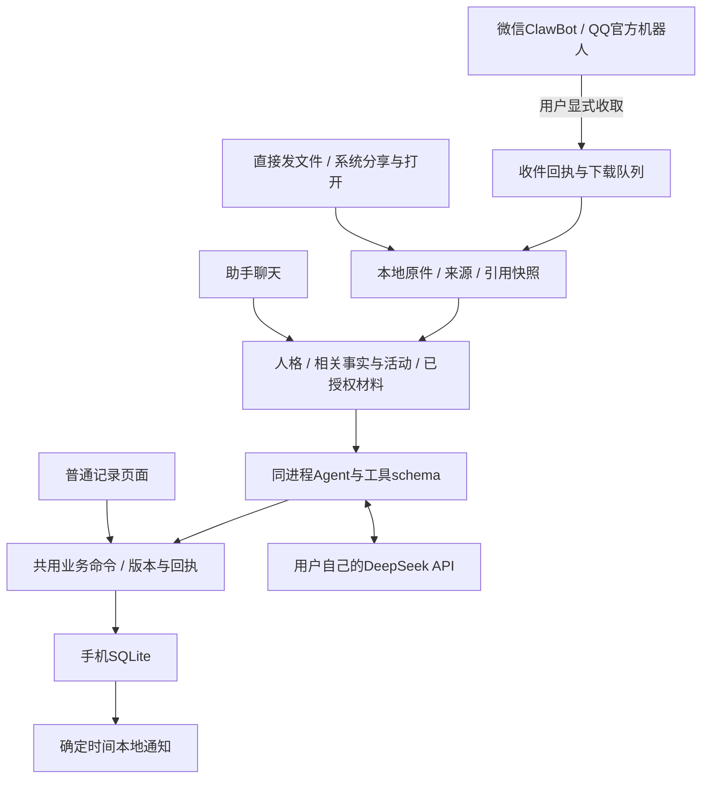

# 产品与架构设计

日期：2026-10-09。目标冻结：酸橙是单人Android应用，不包含自建服务器、账号/联网社交与同步后台。外部网络仅服务于用户主动调用的模型/消息接口。

## 1. 使用结构

保留现有导航，不在本轮为追求蓝图更换页面体系。日常职责：今日概览、待办、习惯、日记、助手；备忘录入口应易发现，回收站/收件箱/设置在菜单。不是所有模块都做大卡片，也不将系统设置塞入日记。

| 页面 | 核心操作 | AI关系 |
|---|---|---|
| 今日/待办 | 查、建、改、完成、按日期查看 | 操作结果从聊天可打开；无独立AI面板 |
| 习惯 | 目标/频次、打卡、历史、归档 | 助手通过相同命令操作；训练活动完成关联打卡 |
| 日记 | 紧凑日期流、阅读、写作、补日期、草稿、搜索、回收站 | 仅按需引用/交给助手；不默认扫描 |
| 备忘录 | 简单文字/分类、编辑、检索、恢复 | 明确选择材料后进入聊天 |
| 助手 | 人格化聊天、文件/图片、引用记录、工具结果/建议 | 唯一主要AI交互入口 |
| 收件箱 | 点击收取微信/QQ、来源/批次、下载状态、选择处理 | 复用聊天材料管线，可设置用户授权的批次处理偏好 |
| 设置 | 模型/Key、角色、明确偏好/记忆、平台绑定、通知、导出恢复 | 不引入账号注册与服务器配对 |

基础字号/行高延续紧凑设计，视觉经人工评审后调整；不用任意缩放系数将整体变大。内容为主，设置集中，工具结果简短可打开。

## 2. 运行结构

一份可变业务数据、一套业务命令、一个会话的单一执行器。手机事务完成后才说已保存，不等待已排除的服务器确认。模型不直接操作SQL、文件目录或系统命令；失败/中断与已提交操作有可恢复状态。

模块逐步引入，不立刻移动所有UI：`src/storage`负责唯一的本地schema/初始化/设置；`src/domain`负责命令/校验/版本/回执；`src/agent`负责provider-independent运行、工具、上下文；`src/integrations`负责DeepSeek/腾讯渠道/系统分享适配；`src/platform`负责文件/通知。当前screens/components保留成熟编辑器；src/records管理通用资料与结构校验，旧远程适配已移除。

## 3. 数据对象与持久化

下表是本地逻辑对象，不要求立刻为每个对象创建多个通用框架。核心可检索字段明确，扩展信息有限JSON；常规查询与全文优先，确有需要再加向量。

| 对象 | 关键内容与约束 |
|---|---|
| Document/Group | diary/memo、标题/正文/日期/分类、稳定ID、版本、原文/草稿/软删除；重用当前记录格式 |
| Record | 广泛资料；type_key/schema_key/schema_version、标题/正文、受校验payload、标签/发生时间、来源/版本/软删除；程序注册text/table结构，内容领域无需建专用表 |
| Task | 标题、状态、日期/时间、注释、来源/版本；LLM不负责精确数值计算 |
| Habit/Checkin | 目标/频次、时间/感受；普通打卡可一天多次，不能用日期唯一约束误杀；活动完成用operation/activity去重 |
| Conversation/Message | 原始消息、选定材料、工具结果、停止/失败/提交状态；不只保存展示文本 |
| Activity | 建议后的目标/关联习惯、状态与时间、完成关联打卡；换会话仍可接续，歧义可问 |
| Persona/Profile | 用户选择/导入的角色规则与交流风格；角色虚构背景不能成为个人事实 |
| MemoryFact | 明确事实/偏好、来源、确认/推断状态、有效期/更正/失效；显示并支持忘记 |
| Source/Attachment/Grant | 原件私有路径、MIME/大小/hash、平台原发布时间/接收时间、版本快照、授权范围；材料不是指令 |
| Proposal/Operation | 推导行动候选、可编辑选择；命令ID、目标版本、事务结果、重复回执/撤销条件 |
| ReminderRule/Occurrence | 到期/重复/提前规则、时区、排程标识、更正/取消；通知状态与业务规则分开 |
| Receipt/Recovery | 分享/渠道/导入去重、原文副本、失败下载/待处理材料；删除策略明确且可恢复 |

Key、机器人凭据存SecureStore，永不进入普通记录导出。数据库和原件保存本机；程序缓存可清，用户原件/日记不当临时文件删除。

当前产品独立启动：SQLite是唯一记录与设置来源，不依赖历史JSON、旧库搬运或服务器缓存。仅支持当前完整ZIP数据包v4的验证与受控恢复；不维护旧格式转换。已有来源快照、草稿与恢复副本属于当前数据，不是历史兼容层。

## 4. AI行为与人格记忆

每轮上下文只包含：系统工具边界、当前私人人格、相关的明确偏好/事实、有限对话/未完成活动、用户本轮材料与允许查询的业务摘要。模型在需要时查询待办/习惯；不将全库日记或全部文件塞入请求。

明确要求“记住/改成/忘掉”可以执行记忆命令；从日记推断的长期结论先成为可编辑候选。临时疲劳/情绪注明时间，不自动永久化。安洁莉娜配置由用户在手机私密导入，公开源码仅给中性默认角色与导入接口。

明确低风险操作字段齐全可直接执行；材料提取的待办先建议，再确认/一次授权策略执行。工具校验ID、版本、来源权限、日期/必填字段、操作ID；原文修改令未接受的旧建议失效。模型说“完成了”不能替代SQLite提交。

自主整理后续只在明确范围内提供分类/关联/归档/合并候选，先可恢复操作与撤销。永久删除、付款和给第三人发消息不交普通工具自行完成。

## 5. 文件和渠道流程

三个入口都进入同一来源体系：先复制原件/登记回执→解析支持格式→选定处理范围→聊天/提取→建议或明确命令→本地保存→结果和原文回看。保留原始材料，不只留模型摘要。

微信/QQ设置分别绑定本人；点击“读取”时前台建立连接，保存消息后登记游标/回执，下载可恢复，取消后不丢已收记录。消息进库和游标推进要保证可恢复；文件下载不因一个失败阻塞整个批次。无需实时后台、公开Webhook或第三方账户自动化。

机器人窗口只接收本人发/转发给它的内容，不读取全部群聊。平台需支持有效的机器人身份和消息权限；合并转发、离线时间窗口与过期链接分别实测。无法补收时清楚提示，直接发文件/系统分享仍可用；不增加隐藏服务器兜底。

## 6. 提醒与场景

确定时间提醒本地预排，创建时准备显示内容；到点无需调用模型。更正/取消撤旧，重复规则续排有标识与防重，时区明确。权限拒绝、重启、HyperOS限制有可见状态，不能仅以应用内列表验收送达。

成绩、训练测量、支出等都使用同一Record结构，原始字段/单位由所选资料决定，精确统计由代码处理；训练记录按实际需要扩项目/量/感受与恢复，不默认健康推断。生日/偏好/通知是通用对象的组合，而不是不同服务。
